# Requirements

## WDD_Requirements

```mermaid
mindmap
  root((CLIバレットジャーナル))
    US01["[US-01] PC作業ユーザーとして、ターミナルから素早くタスクや補足を記録したい、なぜなら手書きの'△ やることリスト'と同等の低摩擦でアイデアを開示・記録したいからだ"]
      AC01["[AC-01] ターミナルから1行コマンドで待たされず'△ やることリスト'へ即座に追記できること"]
        TP01["[テスト観点-01] 正常系タスク追記: 指定記号または通常タスクとして'△ やることリスト'末尾へ追記される検証"]
          BDD01_1["[BDD 01-1] Given: ターミナルが開いている / When: bujo t 'タスク内容' を実行 / Then: 0.1秒以内に'△ やることリスト'へ'• タスク内容'として追記され正常終了"]
            EARS01["[EARS-01] イベント駆動型: ユーザーがタスク追記コマンドを実行したとき、システムは当日の'△ やることリスト'セクション末尾へ対象タスクを追記しなければならない。"]
        TP02["[テスト観点-02] サブタスク・補足追記: 直前タスクの配下にインデント（L記法）で補足メモが紐づく検証"]
          BDD01_2["[BDD 01-2] Given: 直前に登録されたタスクが存在する / When: bujo sub '補足内容' を実行 / Then: 直前タスクの下にインデントされたサブ項目として追記される"]
            EARS02["[EARS-02] イベント駆動型: ユーザーがサブタスク追記を実行したとき、システムは直前タスクの子要素としてインデント形式で追記しなければならない。"]
        TP03["[テスト観点-03] ユーザビリティ（記号省略）: 記号を明示しなくてもエラーにならず標準タスクとして受け付ける検証"]
          BDD01_3["[BDD 01-3] Given: ターミナルが開いている / When: 記号指定なしで bujo 'タスク内容' を実行 / Then: デフォルトで'△ やることリスト'へ追記される"]
            EARS03["[EARS-03] イベント駆動型: ユーザーが種別を省略して実行したとき、システムはデフォルトで'△ やることリスト'へ追記しなければならない。"]
        TP04["[テスト観点-04] 堅牢性（クォート省略）: 複数単語を空白区切りで渡しても1つの文として結合される検証"]
          BDD01_4["[BDD 01-4] Given: ターミナルが開いている / When: bujo 明日の 会議 資料作成 と実行 / Then: 引数が空白結合されて1行のタスクとして記録される"]
            EARS04["[EARS-04] イベント駆動型: ユーザーが複数の文字列引数を渡したとき、システムはそれらを空白区切りで単一のタスク本文として結合し追記しなければならない。"]

      AC02["[AC-02] 引数なし実行時、当日の手帳（やることリスト＋ふりかえり）が即座に俯瞰できること"]
        TP05["[テスト観点-05] 表示機能（通常時）: 当日の全セクションが整形出力される検証"]
          BDD01_5["[BDD 01-5] Given: ログが存在する / When: bujo を単体実行 / Then: 日付ヘッダー、'△ やることリスト'、'△ ふりかえり'が整形表示されて即終了"]
            EARS05["[EARS-05] イベント駆動型: ユーザーが引数を指定せずに bujo コマンドを実行したとき、システムは当日の全セクション内容を標準出力へ表示しなければならない。"]
        TP06["[テスト観点-06] 状態遷移（新規日）: 初回実行時に手帳のテンプレートが自動生成される検証"]
          BDD01_6["[BDD 01-6] Given: 当日ログ未作成 / When: bujo を実行 / Then: 日付と空の'△ やることリスト'・'△ ふりかえり'が生成され案内が表示される"]
            EARS06["[EARS-06] 状態駆動型: 当日のログファイルが存在しない状態においてコマンドが実行された場合、システムは日付と2大セクションの雛形を自動生成しなければならない。"]

      AC03["[AC-03] タスク追記直後に手帳全体が自動再描画され、最新の状況が視界に入ること"]
        TP07["[テスト観点-07] 視認性・即時フィードバック: 追記後に一覧が再描画され、最新行がハイライトされる検証"]
          BDD01_7["[BDD 01-7] Given: ログが存在する / When: タスク追記を実行 / Then: 保存直後に今日の手帳全体が再描画され、追加された行が強調表示される"]
            EARS07["[EARS-07] イベント駆動型: ログ追記コマンドを実行したとき、システムは永続化直後に当日の手帳全体を再描画し、新規項目を強調表示しなければならない。"]

    US02["[US-02] PC作業ユーザーとして、一日の終わりにタスクの棚卸しと自由なふりかえりを書き殴りたい、なぜなら思考や所感をダンプして自分を客観的に俯瞰・観察したいからだ"]
      AC04["[AC-04] タスクの状態更新（完了'O'/移行'>'/取消）をスムーズに行えること"]
        TP08["[テスト観点-08] 対話棚卸し: 未完了タスクが1問1答で提示され、状態を1キーで更新できる検証"]
          BDD02_1["[BDD 02-1] Given: 未完了タスクが存在する / When: bujo review を実行し各タスクの状態を選択 / Then: 対象タスクの記号が'O'（完了）や'>'（移行）へ更新される"]
            EARS08["[EARS-08] イベント駆動型: ユーザーがレビューコマンドを実行したとき、システムは未完了タスクを順次提示して状態更新を受け付け、記号を書き換えなければならない。"]
        TP09["[テスト観点-09] 中断保護: 対話レビューを途中で止めても直前までの更新がファイルに保持される検証"]
          BDD02_2["[BDD 02-2] Given: レビュー進行中 / When: Ctrl+Cで中断 / Then: 直前までに確定したタスク更新が保持されて安全に終了する"]
            EARS09["[EARS-09] 不要動作型: レビュー中にユーザーによる中断が発生した場合、システムは確定済みの状態更新を保持して終了しなければならない。"]

      AC05["[AC-05] レビューで移行（>）を選択したタスクが、翌日の'△ やることリスト'へ自動転記されること"]
        TP10["[テスト観点-10] 翌日自動転記: 翌日ファイルの'△ やることリスト'へ未完了タスクとして引き継がれる検証"]
          BDD02_3["[BDD 02-3] Given: 移行対象タスクがある / When: reviewで移行を選択 / Then: 当日は'>'になり、翌日ファイルの'△ やることリスト'に未完了タスクとして追記される"]
            EARS10["[EARS-10] イベント駆動型: ユーザーがタスクの移行を選択したとき、システムは翌日の'△ やることリスト'へ対象タスクを未完了タスクとして追記しなければならない。"]

      AC06["[AC-06] エディタ連携または複数行入力により、'△ ふりかえり'欄へ自由な長文テキストを直接ダンプできること"]
        TP11["[テスト観点-11] エディタ起動と追記: bujo reflect 等でエディタが立ち上がり、書いたテキストが'△ ふりかえり'へ保存される検証"]
          BDD02_4["[BDD 02-4] Given: ターミナルが開いている / When: bujo reflect を実行しエディタで文章を保存・終了 / Then: 保存した内容が'△ ふりかえり'セクションへそのまま追記される"]
            EARS11["[EARS-11] イベント駆動型: ユーザーがふりかえり記述コマンドを実行したとき、システムはエディタを起動し、入力されたテキストを'△ ふりかえり'セクションへ追記保存しなければならない。"]

    US03["[US-03] PC作業ユーザーとして、自分のOS環境や好みに合ったエディタを自由に選択・設定してふりかえりを記述したい、なぜなら慣れない操作によるストレスを防ぎスムーズに内省に集中したいからだ"]
      AC07["[AC-07] ユーザーはGUI/CUI問わず任意のエディタを設定でき、bujo reflect 時にそれが優先起動すること"]
        TP12["[テスト観点-12] 設定優先度: 設定ファイル > 環境変数($VISUAL/$EDITOR) > システム標準(nano/notepad) の順で解決される検証"]
          BDD03_1["[BDD 03-1] Given: 設定でcode --waitを指定 / When: bujo reflect を実行 / Then: VS Codeが起動し保存終了までCLIが待機する"]
            EARS12["[EARS-12] 遍在型: システムは、明示的に設定されたエディタを環境変数よりも優先して起動コマンドとして採用しなければならない。"]
        TP13["[テスト観点-13] インタラクティブ設定: bujo config editor コマンドで対話的にエディタを選択・保存できる検証"]
          BDD03_2["[BDD 03-2] Given: ターミナルが開いている / When: bujo config editor を実行しリストから選択 / Then: 設定ファイルが更新され次から反映される"]
            EARS13["[EARS-13] イベント駆動型: ユーザーがエディタ設定コマンドを実行したとき、システムは選択されたエディタ情報を設定ファイルへ永続化しなければならない。"]

    US04["[US-04] PC作業ユーザーとして、過去のデイリーログを手帳をめくるように前後に閲覧したりキーワードで検索したい、なぜなら過去の思考や気づきを素早く振り返り長期的に自分を俯瞰したいからだ"]
      AC08["[AC-08] 相対日付コマンド（prev/next または -1/+1）で過去・未来の手帳を即座に参照できること"]
        TP14["[テスト観点-14] ページめくり表示: bujo prev や bujo -1 で直前の記録日手帳が整形表示される検証"]
          BDD04_1["[BDD 04-1] Given: 過去ログが存在する / When: bujo prev を実行 / Then: 1営業日前の手帳全体が標準出力へ整形表示される"]
            EARS14["[EARS-14] イベント駆動型: ユーザーが過去参照コマンドを実行したとき、システムは対象日付の全ログを整形して表示しなければならない。"]
      AC09["[AC-09] キーワード検索により、一致する過去のふりかえり文章やタスクをハイライト付きで一覧できること"]
        TP15["[テスト観点-15] 全文検索: bujo search <word> で該当日付と該当ブロックが抽出表示される検証"]
          BDD04_2["[BDD 04-2] Given: 過去ログファイル群が存在する / When: bujo search 'EndeavourOS' を実行 / Then: ヒットした日付と該当行が抽出表示される"]
            EARS15["[EARS-15] イベント駆動型: ユーザーが検索コマンドを実行したとき、システムは全デイリーログを走査し一致した行と日付を標準出力へ表示しなければならない。"]

    US05["[US-05] PC作業ユーザーとして、好みに応じて表示言語（日/英）を切り替えて利用したい、なぜなら世界中のユーザーが自然な表現で手帳と対話したいからだ"]
      AC10["[AC-10] 環境変数や設定ファイルに応じて、CLIメッセージおよび手帳の初期ヘッダーが日英で切り替わること"]
        TP16["[テスト観点-16] ロケール自動判定: LANG=en_US環境で英語メッセージ、LANG=ja_JP環境で日本語メッセージが出力される検証"]
          BDD05_1["[BDD 05-1] Given: LANG=en_USのターミナル / When: bujo review を未完了0件で実行 / Then: 'No pending tasks found!' と英語でねぎらいが表示される"]
            EARS16["[EARS-16] 状態駆動型: システムロケールが英語に設定されている場合、システムは全UIプロンプトを英語で表示しなければならない。"]
        TP17["[テスト観点-17] バイリンガルパース: 英語見出し(Todo List)と日本語見出し(やることリスト)の双方が同一パーサーで正しく認識される検証"]
          BDD05_2["[BDD 05-2] Given: 英語ヘッダーの手帳Markdownが存在する / When: 日本語ロケール環境で bujo を実行 / Then: 壊れることなくタスクとふりかえりがパースされて整形出力される"]
            EARS17["[EARS-17] 遍在型: システムは、言語設定に関わらず事前定義された日英両方のセクション見出しを同一セクションとして解釈しなければならない。"]

    US06["[US-06] PC作業ユーザーとして、プリセットされた4つのカラーテーマ（Tokyo Night, Monokai, Nord, Sepia）を気分や好みに応じて自由に切り替えたい、なぜなら環境依存の文字化けを完全に防ぎつつ、心地よいビジュアルで毎日の手帳記録を楽しく習慣化したいからだ"]
      AC11["[AC-11] 4つの定義済みテーマ（Tokyo Night, Monokai, Nord, Sepia）を選択でき、文字化けしない安全な記号と24bit True Colorパレットで手帳が描画されること"]
        TP18["[テスト観点-18] テーマ適用検証: 設定されたテーマ固有のHEXカラーおよび装飾（太字/薄字/取消線）が各セクションに忠実に反映されること"]
          BDD06_1["[BDD 06-1] Given: theme='monokai' が設定されている / When: bujo を実行 / Then: 日付が#66d9ef(Bold)、見出しが#fd971f(Bold)、完了タスクが#75715e(Dim+取消線)で描画される"]
            EARS18["[EARS-18] 状態駆動型: 定義済みテーマ（tokyo-night, monokai, nord, sepia）が設定されている状態において、システムは別表パレット定義に規定されたHEXカラーコードおよびテキスト装飾（太字・薄字・取り消し線）に従って各UI要素を描画しなければならない。"]
        TP19["[テスト観点-19] 記号の安全性検証: 特殊フォント（Nerd Fonts等）を要求しない標準Unicode記号（•, >, O, -, ─）のみで全テーマが描画されること"]
          BDD06_2["[BDD 06-2] Given: 任意のテーマが選択されている / When: 手帳一覧を描画 / Then: Nerd Fontsや絵文字依存のグリフを含まず標準記号のみで描画される"]
            EARS19["[EARS-19] 遍在型: システムは、選択されたテーマに関わらず、端末依存の文字化けを発生させない事前定義された安全なUnicode記号のみを用いて画面を構成しなければならない。"]
      AC12["[AC-12] コマンドによる即時切り替えと、未定義テーマ指定時の安全なフォールバックが機能すること"]
        TP20["[テスト観点-20] コマンドによるテーマ変更とプレビュー: bujo theme <name> で即座に設定が保存され新色で描画されること"]
          BDD06_3["[BDD 06-3] Given: 現在tokyo-nightが適用されている / When: bujo theme nord を実行 / Then: 設定ファイルが更新され、Nordパレットで即座に手帳が再描画される"]
            EARS20["[EARS-20] イベント駆動型: ユーザーが bujo theme <テーマ名> コマンドを実行したとき、システムは指定されたテーマ名を設定ファイルへ永続化し、変更後のテーマパレットで手帳をプレビュー描画しなければならない。"]
        TP21["[テスト観点-21] 不正テーマ名のフォールバック: 未知のテーマ名が指定されてもクラッシュせずデフォルト（tokyo-night）で描画されること"]
          BDD06_4["[BDD 06-4] Given: 不正なテーマ名（例: theme='unknown'）が指定されている / When: bujo を実行 / Then: エラー終了せず警告を表示した上でデフォルトのtokyo-nightテーマを適用して描画する"]
            EARS21["[EARS-21] 不要動作型: 未定義のテーマ名が指定された場合、システムは異常終了することなく警告を出力し、デフォルトテーマ（tokyo-night）へフォールバックして描画しなければならない。"]

```


## Sample Information
### 10/17(火)

#### △ やることリスト
> SIT-1-1-1-001のテスト作る
> PodmanにGitbucketを立ち上げる
  - Lubuntu -> Xubuntuが良いか
> MCP用の変換ツール作成する
  - PDF -> Markdown化

#### △ ふりかえり
EndeavourOSにしたあき！
UXって大事。EndeavourOSでサクサク動き、スクリーンイカができるようになって楽ちんになったし、Win11よりも軽いから使い勝手向上した。仮想キーボードの日本語入力問題……解消頑張ろう。
本は格段に読みやすくなったので、勉強頑張ろう。
テストする気が起きない・・・、仕事やらんでも・・・（未確定情報しかない）。

## Color Theme

US06ように別途詳細記載した内容はこちらを参照すること。

#### 別表：カラーテーマ・パレット定義仕様書
どのOS・端末でも文字化けしない安全な記号体系をベースに、セクションごとの適用色（24bit True Color HEX）とテキスト装飾を規定する。

| UI要素 / セクション | 採用記号・フォーマット例 | スタイル装飾 | Tokyo Night (デフォルト) | Monokai | Nord | Sepia / Craft | 備考 |
| --- | --- | --- | --- | --- | --- | --- | --- |
| 日付ヘッダー | ### MM/DD(曜) | 太字 (Bold) | #7aa2f7 | #66d9ef | #88c0d0 | #d4a373 | 日付全体の最上位見出し |
| セクション見出し | #### △ やることリスト<br>#### △ ふりかえり | 太字 (Bold) | #bb9af7 | #fd971f | #81a1c1 | #bc6c25 | 各手帳ブロックのタイトル |
| 未完了タスク | • タスク内容 | 通常 (Normal) | #c0caf5 | #f8f8f2 | #eceff4 | #faedcd | U+2022 (Bullet) を使用 |
| 完了タスク | O タスク内容 または [x] タスク内容 | 薄字 (Dim) +取り消し線 (Strikethrough) | #565f89 | #75715e | #4c566a | #8c8275 | 完了状態の視覚的減衰 |
| 移行タスク | &gt; タスク内容 | 通常 (Normal) | #e0af68 | #e6db74 | #ebcb8b | #b08968 | 翌日繰り越し済みタスク |
| サブタスク / 補足 | &nbsp;&nbsp;- 補足内容 | 通常 (Normal) | #9aa5ce | #a6e22e | #d8dee9 | #ddb892 | 半角スペース2個のインデント |
| ふりかえり本文 | 自由記述テキスト | 通常 (Normal) | #c0caf5 | #f8f8f2 | #eceff4 | #faedcd | 複数行テキストの基本描画色 |
| [NEW] 強調バッジ | [NEW] | 太字 (Bold) | #9ece6a | #a6e22e | #a3be8c | #6b705c | 直前入力項目の識別バッジ |
| 区切り線 / 罫線 | --- または ─ | 薄字 (Dim) | #3b4261 | #49483e | #3b4252 | #d5bdaf | 標準罫線文字 U+2500 を使用 |

#### 設定ファイル（デフォルトTOML表現例）
参考となるTOML表現

```toml
[general]
theme = "tokyo-night"

[themes.tokyo-night]
date_header = "#7aa2f7"
section_header = "#bb9af7"
task_pending = "#c0caf5"
task_done = "#565f89"
task_migrated = "#e0af68"
task_sub = "#9aa5ce"
reflection_text = "#c0caf5"
badge_new = "#9ece6a"
border = "#3b4261"

[themes.monokai]
date_header = "#66d9ef"
section_header = "#fd971f"
task_pending = "#f8f8f2"
task_done = "#75715e"
task_migrated = "#e6db74"
task_sub = "#a6e22e"
reflection_text = "#f8f8f2"
badge_new = "#a6e22e"
border = "#49483e"

[themes.nord]
date_header = "#88c0d0"
section_header = "#81a1c1"
task_pending = "#eceff4"
task_done = "#4c566a"
task_migrated = "#ebcb8b"
task_sub = "#d8dee9"
reflection_text = "#eceff4"
badge_new = "#a3be8c"
border = "#3b4252"

[themes.sepia]
date_header = "#d4a373"
section_header = "#bc6c25"
task_pending = "#faedcd"
task_done = "#8c8275"
task_migrated = "#b08968"
task_sub = "#ddb892"
reflection_text = "#faedcd"
badge_new = "#6b705c"
border = "#d5bdaf"
```